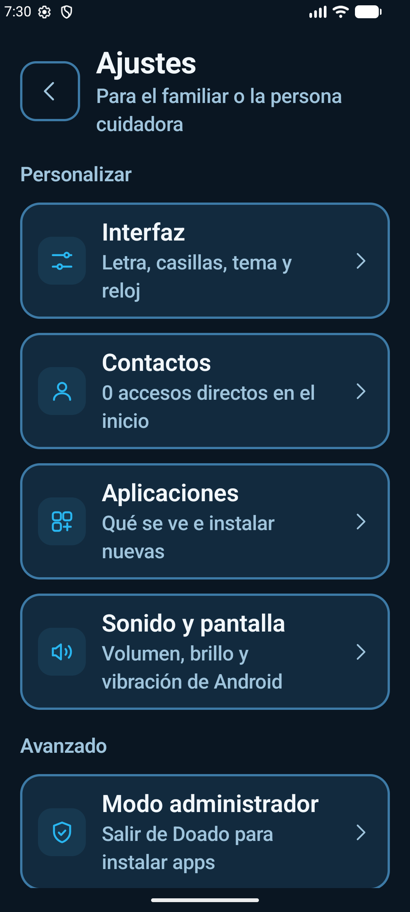

# Doado

**Una app para tus mayores.**

Doado es un *launcher* de Android —la pantalla de inicio del móvil— pensado para
personas mayores que se pelean con el teléfono: menos cosas en pantalla, más
grandes y con mucho más contraste que en un lanzador normal.

La idea de fondo: el móvil lo usa una persona, pero lo configura otra. Así que
Doado tiene dos caras. Por delante, una pantalla de inicio sin nada que
descubrir. Por detrás, y tras un PIN, todos los ajustes para el familiar que se
encarga de dejarlo a punto.

---

## Así se ve

| Pantalla de inicio | Entrar en los ajustes |
| --- | --- |
|  |  |

| Ajustes | Modo administrador |
| --- | --- |
|  |  |

---

## Para quién

| Perfil | Qué hace | Dónde vive en la app |
| --- | --- | --- |
| **La persona mayor** | Llama, escribe, hace fotos. Todos los días, y siempre igual. | La pantalla de inicio. No llega nunca a los ajustes. |
| **El familiar o cuidador** | Deja el móvil configurado: qué apps se ven, a quién se llama de un toque, cómo de grande es la letra. | Ajustes, detrás del PIN. |
| **El asistente de voz** (pendiente) | Recibe órdenes habladas y las ejecuta, o guía paso a paso para hacerlas. | Por definir. |

Cuando el familiar necesita tocar Android por debajo —instalar apps, entrar en
los ajustes del sistema o cambiar la pantalla de inicio— activa el **modo
administrador**, que no es un perfil aparte sino un estado que dura 15 minutos.

---

## Qué hace hoy

### Pantalla de inicio

- **Reloj y fecha** grandes, con el isotipo de la marca.
- **Accesos directos de personas**: hasta cuatro contactos con su nombre. Un
  toque y les llama (o les abre WhatsApp).
- **Casillas de aplicaciones** en una o dos columnas, que se estiran para
  ocupar la pantalla. Si una app no está instalada, su casilla **se queda en su
  sitio pero apagada**: la posición de cada icono es memoria muscular.
- **Botón de Ajustes** abajo del todo, en tono apagado y con candado.

### Ajustes, para el familiar

Detrás de un **PIN de cuatro cifras**, que se crea la primera vez que se entra.

| Apartado | Qué permite |
| --- | --- |
| **Interfaz** | Tamaño de letra (tres niveles, encima del que ya tenga Android), una o dos casillas por fila, tema claro u oscuro, y mostrar o no el reloj. Con una maqueta en pequeño que va cambiando. |
| **Contactos** | Elegir personas del listín del móvil, decidir si cada una llama o abre WhatsApp, y cuáles salen en el inicio (caben cuatro). |
| **Aplicaciones** | Encender y apagar las casillas, instalar las recomendadas (WhatsApp, Sofascore) y subir al inicio cualquier otra app del móvil. |
| **Sonido y pantalla** | Atajo a los ajustes de Android de volumen, brillo y vibración. |
| **Modo administrador** | Ver más abajo. |
| **PIN de ajustes** | Cambiar las cuatro cifras. |

### Modo administrador

Doado, siendo la pantalla de inicio, cierra sus propias salidas. El modo
administrador **las abre durante quince minutos**, con cuenta atrás a la vista, y
se cierra solo cuando acaba el tiempo. Mientras dura se habilitan:

- la tienda de aplicaciones,
- los ajustes de Android,
- y el cambio de pantalla de inicio.

Con el modo activo, la pantalla de inicio enseña un aviso con la hora a la que
se volverá a cerrar.

> **Lo que este modo no puede hacer:** impedir de verdad que alguien salga a
> Android. Para eso Doado tendría que ser «propietaria del dispositivo», que es
> otra liga. Lo que hace es cerrar bajo llave las salidas que ofrece la propia
> app, que son por donde se sale en la práctica.

---

## La norma que no se salta

> **Toda UI nueva prioriza la accesibilidad sobre la estética.**

- **Contraste**: mínimo 4,5:1 con el fondo; para texto y bordes se busca 7:1. El
  cian de la marca se queda en 2,2:1 sobre blanco, así que **no se usa para
  texto ni iconos sobre fondo claro**.
- **Objetivo táctil**: nunca por debajo de 48 dp. En la práctica, mucho más: las
  casillas del inicio pasan de 168 dp.
- **Texto** siempre en `sp` y desde la escala del tema (≈1,5 veces la de
  Material), para que respete el tamaño de letra del sistema.
- **Separación por borde, no por sombra**: una sombra suave desaparece para
  quien tiene poca sensibilidad al contraste.
- **Nada de color dinámico** (Material You): tomar los colores del fondo de
  pantalla haría imposible garantizar el contraste.
- **Sin sitios que bailen**: una app que no esté disponible se pinta apagada,
  pero no se quita.
- Etiquetas de TalkBack en todo lo pulsable; los iconos con texto al lado son
  decorativos, para no oírlo dos veces.

---

## Cómo está hecho

**Kotlin + Jetpack Compose** (Material 3), un único módulo Gradle (`:app`), sin
XML de layouts. minSdk 24, compileSdk y targetSdk 37.

> **AGP 9**: el plugin de Android ya trae Kotlin integrado, así que en
> `app/build.gradle.kts` **no** se aplica `org.jetbrains.kotlin.android` —
> hacerlo rompe el build. Las versiones se tocan solo en
> `gradle/libs.versions.toml`.

### Estructura

Se organiza **por feature, no por capa**:

```
app/src/main/java/com/doado/
├── launcher/       Pantalla de inicio y la Activity, que lleva la navegación
│                   y todo lo que abre Intents.
├── settings/       Ajustes: PIN, interfaz, contactos, apps y modo administrador.
├── assistant/      (vacío) Asistente de voz.
├── core/ui/        Tema, medidas y las piezas comunes de interfaz.
└── data/           Apps instaladas, casillas, contactos y ajustes guardados.
```

El `namespace` es `com.doado` y el `applicationId`, `com.doado.launcher`. Es a
propósito: así el paquete de feature puede llamarse `launcher` sin acabar en
`com.doado.launcher.launcher`. La clase `R` es `com.doado.R`.

### Navegación y estado

No hay librería de navegación: son pocas pantallas y planas. Un `enum` y un
`when` en `LauncherActivity`, con el estado en la propia Activity. El botón
**ATRÁS** sube un escalón; el botón **INICIO** del móvil vuelve siempre a la
pantalla de inicio.

### Qué se guarda

Tres ficheros de preferencias, los tres incluidos en las reglas de copia de
seguridad:

| Fichero | Contenido |
| --- | --- |
| `doado_favorites` | Qué casillas salen en el inicio y en qué orden. |
| `doado_contacts` | Los accesos directos de personas. |
| `doado_settings` | Tema, letra, columnas, reloj, el PIN y el fin del modo administrador. |

### Visibilidad de paquetes

El bloque `<queries>` del manifiesto no es opcional: desde Android 11, sin él el
`PackageManager` no ve el resto de apps y el inicio saldría vacío. **Si se añade
un favorito nuevo, hay que declarar también su intención ahí.** Los favoritos se
definen por **acción** (`ACTION_DIAL`, `CATEGORY_APP_MESSAGING`…) y no por
paquete, para que funcionen sea cual sea la marca del móvil.

---

## Compilar y probar

Hace falta Android Studio (o el SDK de Android) y un `local.properties` con la
ruta del SDK — está en `.gitignore` porque es propio de cada equipo:

```
sdk.dir=C\:\\Users\\<usuario>\\AppData\\Local\\Android\\Sdk
```

```bash
./gradlew assembleDebug     # compila el APK de depuración
./gradlew installDebug      # lo instala en el dispositivo o emulador conectado
./gradlew lint              # análisis estático de Android
```

### Verlo como pantalla de inicio

Instalar no basta: hay que decirle a Android que use Doado.

- **En el móvil o el emulador**: pulsa el botón de Inicio y elige Doado →
  *Siempre*. Si no sale el selector, está en *Ajustes → Aplicaciones →
  Aplicaciones predeterminadas → App principal*.
- **Desde el ordenador**:
  ```bash
  adb shell cmd package set-home-activity com.doado.launcher/.LauncherActivity
  ```

### Si algo se rompe

Un launcher roto deja el móvil sin pantalla de inicio. Para recuperarlo:

```bash
adb shell cmd package set-home-activity <otro.paquete/.SuActividad>   # devolver el mando
adb uninstall com.doado.launcher                                      # último recurso
```

Desinstalar o borrar los datos de la app pierde el PIN, los contactos y las
casillas. Es también la salida cuando **se olvida el PIN**.

---

## Estado del proyecto

El producto completo son dos piezas:

| Pieza | Estado |
| --- | --- |
| **Launcher** — inicio, ajustes, contactos, apps y modo administrador | implementado |
| **Asistente de voz** | pendiente, carpeta vacía |

Probado a mano en emulador (Android 16, Pixel). **No hay pruebas automáticas**
ni traducciones: la app está solo en español.

### Límites conocidos

Lo que hay que arreglar:

- **Un PIN olvidado no se puede recuperar**: al guardarse derivado, la única
  salida es borrar los datos de la app. Está por decidir si habrá otra
  (conflicto CON-05 de la ERS).

Asumido, y escrito para no volver a discutirlo:

- El modo administrador no puede impedir salir a Android.
- La cuenta atrás va contra la hora del sistema: cambiarla altera el desbloqueo.
- El número de un contacto se congela al añadirlo; si cambia en la agenda, Doado
  sigue con el viejo.
- No hay videollamada: Android no ofrece una forma estándar de iniciarla.
- Las casillas y los contactos no se pueden reordenar; las nuevas van al final.

---

## Diseño y documentación

| Dónde | Qué hay |
| --- | --- |
| [`docs/ERS.md`](docs/ERS.md) | La especificación de requisitos: actores, casos de uso con su estado, requisitos no funcionales, alternativas existentes y decisiones pendientes. |
| [`docs/arquitectura.md`](docs/arquitectura.md) | Cómo está construido por dentro: navegación, estado, qué se guarda y con qué claves, los intents con sus reservas y el manifiesto. |
| [`docs/diseno.md`](docs/diseno.md) | Paleta con sus contrastes, tipografía, medidas, iconografía y los componentes compartidos. |
| [`docs/decisiones.md`](docs/decisiones.md) | Por qué cada cosa es como es y qué se descartó por el camino. |
| [`docs/estado.md`](docs/estado.md) | En qué punto está el trabajo. Es el único documento que caduca. |
| [`design/presentacion/doado-de-un-vistazo.pdf`](design/presentacion/doado-de-un-vistazo.pdf) | El proyecto en diez láminas: perfiles, mapa de pantallas, un flujo por perfil, arquitectura, sistema visual y estado. Para presentar. |
| `design/presentacion/ver-presentacion.html` | Las mismas diez láminas en el navegador. |
| `design/*.dc.html` | El lienzo donde se diseñó la interfaz antes de escribirla. |
| `CLAUDE.md` y `.claude/rules/` | El índice del proyecto y las normas de trabajo para quien (o lo que) toque el código. |

Si el lienzo de diseño y el código no cuadran, **manda el código**.
