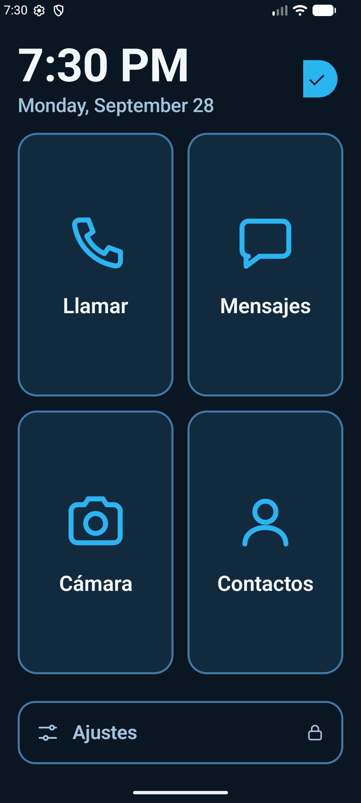
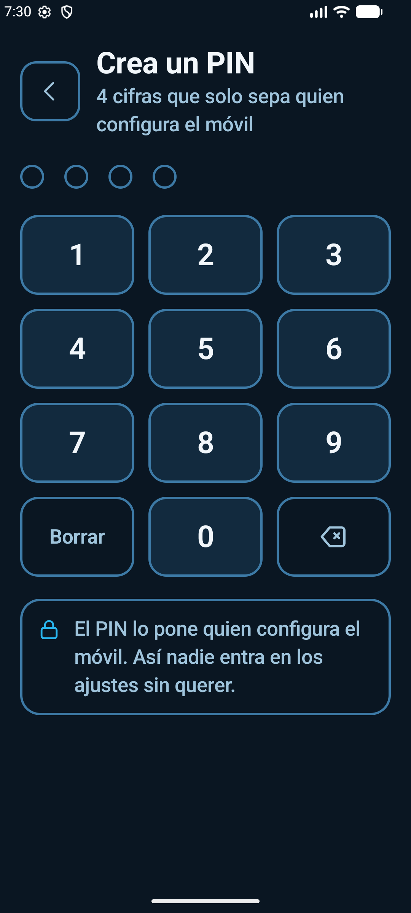
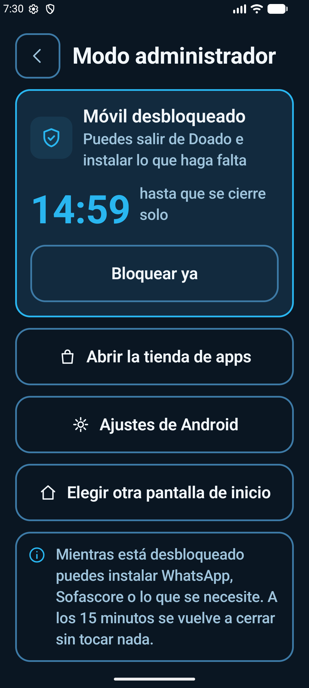

# Doado

**Una app para tus mayores.**

Doado es un *launcher* de Android —la pantalla de inicio del móvil— pensado para
personas mayores que se pelean con el teléfono: menos cosas en pantalla, más
grandes y con mucho más contraste que en un lanzador normal.

La idea de fondo: el móvil lo usa una persona, pero lo configura otra. Así que
Doado tiene dos caras. Por delante, una pantalla de inicio sin nada que
descubrir. Por detrás, y tras un PIN, todos los ajustes para el familiar que se
encarga de dejarlo a punto.

---

## Así se ve

| Pantalla de inicio | Entrar en los ajustes |
| --- | --- |
|  |  |

| Ajustes | Modo administrador |
| --- | --- |
|  |  |

---

## Para quién

| Perfil | Qué hace | Dónde vive en la app |
| --- | --- | --- |
| **La persona mayor** | Llama, escribe, hace fotos. Todos los días, y siempre igual. | La pantalla de inicio. No llega nunca a los ajustes. |
| **El familiar o cuidador** | Deja el móvil configurado: qué apps se ven, a quién se llama de un toque, cómo de grande es la letra. | Ajustes, detrás del PIN. |
| **El asistente de voz** (en pruebas) | Recibe órdenes habladas y las hace diciendo antes qué va a hacer, o guía paso a paso para hacerlas. | Un círculo fijo en el inicio. |

Cuando el familiar necesita tocar Android por debajo —instalar apps, entrar en
los ajustes del sistema o cambiar la pantalla de inicio— activa el **modo
administrador**, que no es un perfil aparte sino un estado que dura 15 minutos.

---

## Qué hace hoy

### Pantalla de inicio

- **Reloj y fecha** y, en la esquina, un **botón pequeño de Ajustes**,
  en tono apagado y lejos del pulgar.
- **Accesos directos de personas**: casillas con su nombre y la foto que tienen en
  la agenda, debajo de las apps y tras el rótulo «Contactos favoritos», sin
  límite, o en una segunda pantalla a la que se pasa deslizando o con su pestaña.
  Un toque y les llama o les abre WhatsApp; la misma persona puede tener los dos
  botones.
- **Casillas de aplicaciones** de una a cuatro por fila, siempre cuadradas (con
  una, filas): nunca se estiran, y el nombre se encoge lo justo para caber
  entero, sin partir palabras. El familiar decide dónde va cada una. Si una app no
  está instalada, su casilla **se queda en su sitio pero apagada**: la posición
  de cada icono es memoria muscular.
- **El círculo del asistente**, abajo en el centro, si el familiar lo enciende.
- **Una foto de fondo**, si el familiar la pone, con el reloj y los rótulos sobre
  una franja lisa para que se sigan leyendo.
  No se mueve con la rejilla ni tapa ninguna casilla.

### Asistente de voz

Se pulsa el círculo y se habla con calma: espera a que la persona empiece,
aguanta pausas largas y tiene un botón «Ya he terminado». Puede llamar o abrir el
WhatsApp de un contacto guardado y abrir una casilla del inicio, o explicar cómo
hacer algo con el móvil. Lo que dice en voz alta también se ve escrito.

Una orden, una escucha: deja de oír en cuanto acaba la frase, y lo que suena más
flojo que quien habla (la tele, alguien al fondo) no cuenta. Si no lo ha
entendido, pide que se lo repitan y vuelve a escuchar una vez. Lo hablado se
recuerda mientras está abierto y se olvida al cerrarlo.

El familiar elige el modo: **«Lo hace»**, el de fábrica, que dice lo que va a
hacer («Llamo a María») y lo hace al acabar la frase, con un botón «Cancelar»
mientras tanto, o **«Explica cómo»**, que da los pasos de uno en uno y al acabar
marca en el inicio el botón que hay que pulsar.

La voz se entiende en la nube (hoy Groq, gratis para pruebas). Al servicio solo
le llegan la voz y los nombres, nunca los números de teléfono.

### Ajustes, para el familiar

Detrás de un **PIN de cuatro cifras**, que se crea la primera vez que se entra.
Si Doado aún no es la pantalla de inicio del móvil, el inicio y Ajustes lo avisan
arriba, con un botón para ponerlo.

| Apartado | Qué permite |
| --- | --- |
| **Asistente de voz** | Encender el círculo del inicio (pide el permiso del micrófono) y elegir si lo hace o explica cómo. |
| **Interfaz** | Tamaño de letra (cuatro niveles, combinados con el que ya tenga Android), de una a cuatro casillas por fila, contactos debajo de las apps o en otra pantalla, foto de fondo, tema claro u oscuro, y mostrar o no el reloj. Con una maqueta en pequeño que va cambiando. |
| **Contactos** | Elegir personas del listín del móvil y encender, para cada una, su botón de llamadas, el de WhatsApp o los dos. |
| **Colocar las casillas** | Decidir dónde va cada casilla y cada contacto en el inicio, arrastrándolos o con botones. |
| **Aplicaciones** | Encender y apagar las casillas básicas y subir al inicio cualquier otra app del móvil. Entre las básicas está «Emergencias 112», apagada de fábrica, que abre el teléfono con el 112 marcado. Para instalar, la tienda del modo administrador. |
| **Sonido y pantalla** | Atajo a los ajustes de Android de volumen, brillo y vibración. |
| **Modo administrador** | Ver más abajo. |
| **PIN de ajustes** | Cambiar las cuatro cifras, pidiendo antes las actuales, y fijar una pregunta de recuperación por si se olvidan. |

### Modo administrador

Doado, siendo la pantalla de inicio, cierra sus propias salidas. El modo
administrador **las abre durante quince minutos**, con cuenta atrás a la vista, y
se cierra solo cuando acaba el tiempo. Mientras dura se habilitan:

- la tienda de aplicaciones,
- los ajustes de Android,
- y el cambio de pantalla de inicio.

Con el modo activo, la pantalla de inicio enseña un aviso con la hora a la que
se volverá a cerrar.

> **Lo que este modo no puede hacer:** impedir de verdad que alguien salga a
> Android. Para eso Doado tendría que ser «propietaria del dispositivo», que es
> otra liga. Lo que hace es cerrar bajo llave las salidas que ofrece la propia
> app, que son por donde se sale en la práctica.

---

## La norma que no se salta

> **Toda UI nueva prioriza la accesibilidad sobre la estética.**

- **Contraste**: mínimo 4,5:1 con el fondo; para texto y bordes se busca 7:1. El
  cian de la marca se queda en 2,32:1 sobre blanco, así que **no se usa para
  texto ni iconos sobre fondo claro**.
- **Objetivo táctil**: nunca por debajo de 48 dp. Las casillas del inicio son
  cuadradas y, con dos por fila, pasan de 140 dp; con cuatro, que lo pidieron
  personas mayores en las pruebas, quedan en unos 70 dp.
- **Texto** siempre en `sp` y desde la escala del tema (≈1,5 veces la de
  Material), para que respete el tamaño de letra del sistema. La letra es
  Inter, con la I y la l bien distintas, y va dentro de la app.
- **Separación por borde, no por sombra**: una sombra suave desaparece para
  quien tiene poca sensibilidad al contraste.
- **Nada de color dinámico** (Material You): tomar los colores del fondo de
  pantalla haría imposible garantizar el contraste.
- **Sin sitios que bailen**: una app que no esté disponible se pinta apagada,
  pero no se quita.
- Etiquetas de TalkBack en todo lo pulsable; los iconos con texto al lado son
  decorativos, para no oírlo dos veces.

---

## Cómo está hecho

**Kotlin + Jetpack Compose** (Material 3), un único módulo Gradle (`:app`), sin
XML de layouts. minSdk 24, compileSdk y targetSdk 37.

> **AGP 9**: el plugin de Android ya trae Kotlin integrado, así que en
> `app/build.gradle.kts` **no** se aplica `org.jetbrains.kotlin.android` —
> hacerlo rompe el build. Las versiones se tocan solo en
> `gradle/libs.versions.toml`.

### Estructura

Se organiza **por feature, no por capa**:

```
app/src/main/java/com/doado/
├── launcher/       Pantalla de inicio y la Activity, que lleva la navegación
│                   y todo lo que abre Intents.
├── settings/       Ajustes: PIN, interfaz, contactos, apps y modo administrador.
├── assistant/      Asistente de voz: grabar, entender, hacerlo o guiar.
├── core/ui/        Tema, medidas y las piezas comunes de interfaz.
└── data/           Apps instaladas, casillas, contactos y ajustes guardados.
```

El `namespace` es `com.doado` y el `applicationId`, `com.doado.launcher`. Es a
propósito: así el paquete de feature puede llamarse `launcher` sin acabar en
`com.doado.launcher.launcher`. La clase `R` es `com.doado.R`.

### Navegación y estado

No hay librería de navegación: son pocas pantallas y planas. Un `enum` y un
`when` en `LauncherActivity`, con el estado en la propia Activity. El botón
**ATRÁS** sube un escalón; el botón **INICIO** del móvil vuelve siempre a la
pantalla de inicio.

### Qué se guarda

Cuatro ficheros de preferencias. Los tres primeros van en la copia de seguridad;
el del PIN, a propósito, no:

| Fichero | Contenido |
| --- | --- |
| `doado_favorites` | Qué casillas salen en el inicio y en qué orden. |
| `doado_contacts` | Los accesos directos de personas. |
| `doado_settings` | Tema, letra, columnas, dónde van los contactos, reloj, el asistente y el fin del modo administrador. |
| `doado_security` | El PIN y la respuesta de recuperación, derivados con PBKDF2 y sal (nunca en claro), y la pregunta. |

### Visibilidad de paquetes

El bloque `<queries>` del manifiesto no es opcional: desde Android 11, sin él el
`PackageManager` no ve el resto de apps y el inicio saldría vacío. **Si se añade
un favorito nuevo, hay que declarar también su intención ahí.** Los favoritos se
definen por **acción** (`ACTION_DIAL`, `CATEGORY_APP_MESSAGING`…) y no por
paquete, para que funcionen sea cual sea la marca del móvil.

---

## Compilar y probar

Hace falta Android Studio (o el SDK de Android) y un `local.properties` con la
ruta del SDK — está en `.gitignore` porque es propio de cada equipo:

```
sdk.dir=C\:\\Users\\<usuario>\\AppData\\Local\\Android\\Sdk

# Asistente de voz: sin clave no se puede encender. Gratis en console.groq.com.
doado.ai.apiKey=gsk_...
# Opcionales; estos son los valores por defecto. Vale cualquier proveedor con
# la API de OpenAI.
# doado.ai.baseUrl=https://api.groq.com/openai/v1
# doado.ai.sttModel=whisper-large-v3
# doado.ai.llmModel=openai/gpt-oss-120b
# doado.ai.reasoningEffort=low
```

La clave acaba dentro del APK: sirve para probar, no para publicar (CON-06 en la
ERS). En el emulador, para hablarle: *Extended controls → Microphone → Virtual
microphone uses host audio input*.

```bash
./gradlew assembleDebug     # compila el APK de depuración
./gradlew installDebug      # lo instala en el dispositivo o emulador conectado
./gradlew lint              # análisis estático de Android
```

### Verlo como pantalla de inicio

Instalar no basta: hay que decirle a Android que use Doado.

- **En el móvil o el emulador**: pulsa el botón de Inicio y elige Doado →
  *Siempre*. Si no sale el selector, está en *Ajustes → Aplicaciones →
  Aplicaciones predeterminadas → App principal*.
- **Desde el ordenador**:
  ```bash
  adb shell cmd package set-home-activity com.doado.launcher/.LauncherActivity
  ```

### Si algo se rompe

Un launcher roto deja el móvil sin pantalla de inicio. Para recuperarlo:

```bash
adb shell cmd package set-home-activity <otro.paquete/.SuActividad>   # devolver el mando
adb uninstall com.doado.launcher                                      # último recurso
```

Desinstalar o borrar los datos de la app pierde el PIN, los contactos y las
casillas. Si **se olvida el PIN** y no se fijó pregunta de recuperación, es la
única salida.

---

## Estado del proyecto

El producto completo son dos piezas:

| Pieza | Estado |
| --- | --- |
| **Launcher** — inicio, ajustes, contactos, apps y modo administrador | implementado |
| **Asistente de voz** | programado, en pruebas: falta probarlo con voz real |

Probado a mano en emulador (Android 16, Pixel). **No hay pruebas automáticas**
ni traducciones: la app está solo en español.

### Límites conocidos

Lo que hay que arreglar:

- **La clave del servicio de voz va dentro del APK** y se puede extraer. Hay que
  resolverlo antes de publicar (CON-06).

Asumido, y escrito para no volver a discutirlo:

- El modo administrador no puede impedir salir a Android.
- La cuenta atrás va contra la hora del sistema: cambiarla altera el desbloqueo.
- El número de un contacto se congela al añadirlo; si cambia en la agenda, Doado
  sigue con el viejo. La foto sí se actualiza.
- No hay videollamada: Android no ofrece una forma estándar de iniciarla.
- Las casillas y los contactos nuevos van al final; luego el familiar los coloca
  donde quiera en «Colocar las casillas».

---

## Diseño y documentación

| Dónde | Qué hay |
| --- | --- |
| [`docs/ERS.md`](docs/ERS.md) | La especificación de requisitos: actores, casos de uso con su estado, requisitos no funcionales, alternativas existentes y decisiones pendientes. |
| [`docs/arquitectura.md`](docs/arquitectura.md) | Cómo está construido por dentro: navegación, estado, qué se guarda y con qué claves, los intents con sus reservas y el manifiesto. |
| [`docs/diseno.md`](docs/diseno.md) | Paleta con sus contrastes, tipografía, medidas, iconografía y los componentes compartidos. |
| [`docs/decisiones.md`](docs/decisiones.md) | Por qué cada cosa es como es y qué se descartó por el camino. |
| [`docs/estado.md`](docs/estado.md) | En qué punto está el trabajo. Es el único documento que caduca. |
| [`design/presentacion/doado-de-un-vistazo.pdf`](design/presentacion/doado-de-un-vistazo.pdf) | El proyecto en diez láminas: perfiles, mapa de pantallas, un flujo por perfil, arquitectura, sistema visual y estado. Para presentar. |
| `design/presentacion/ver-presentacion.html` | Las mismas diez láminas en el navegador. |
| `web/index.html` | La web de presentación, por secciones y con un móvil de Doado que se puede tocar. Se abre sin servidor. |
| `design/video/` | El vídeo de marca de 53 s (1920 × 1080, 60 fps) con su música, y el código para volver a sacarlo. |
| `design/*.dc.html` | El lienzo donde se diseñó la interfaz antes de escribirla. |
| `CLAUDE.md` y `.claude/rules/` | El índice del proyecto y las normas de trabajo para quien (o lo que) toque el código. |
| `.claude/skills/doado-brand/` | La marca: logo, colores, iconos, letra y tono, con los ficheros del logo. |

Si el lienzo de diseño y el código no cuadran, **manda el código**.
