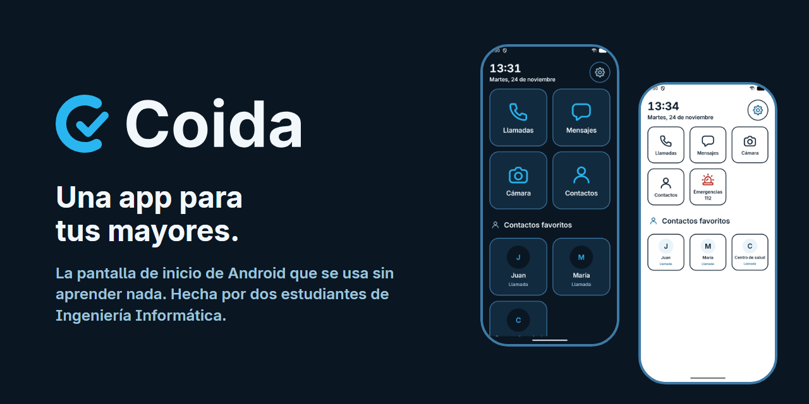
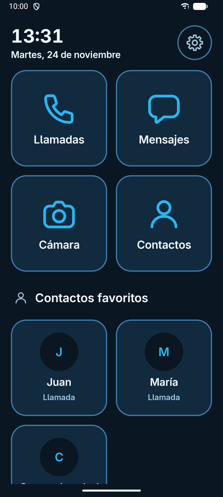
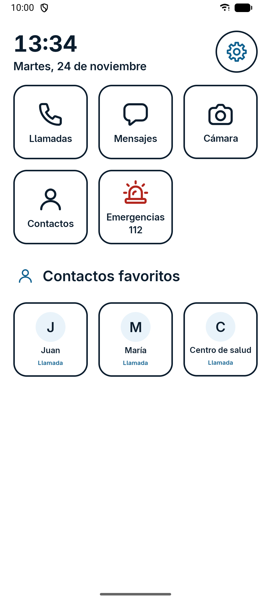
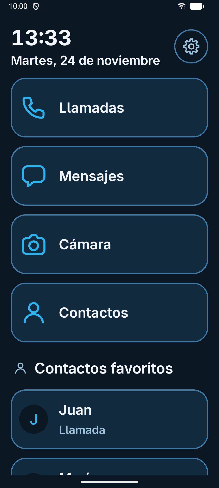
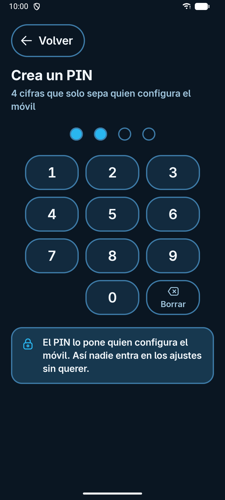
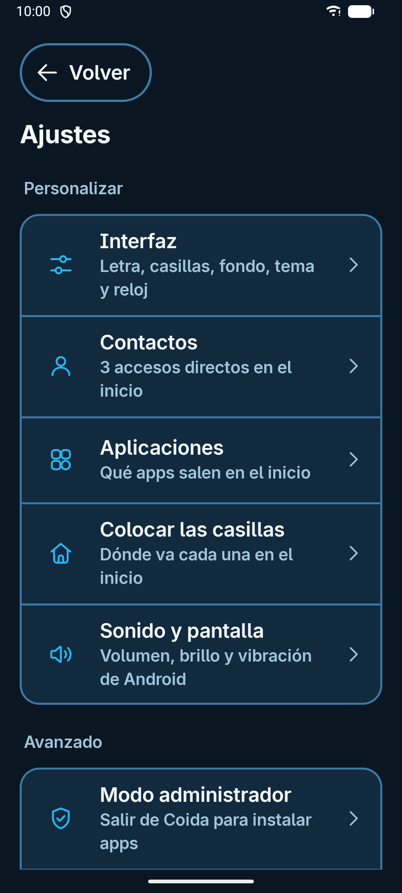
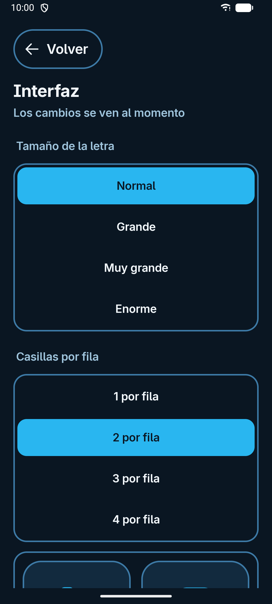
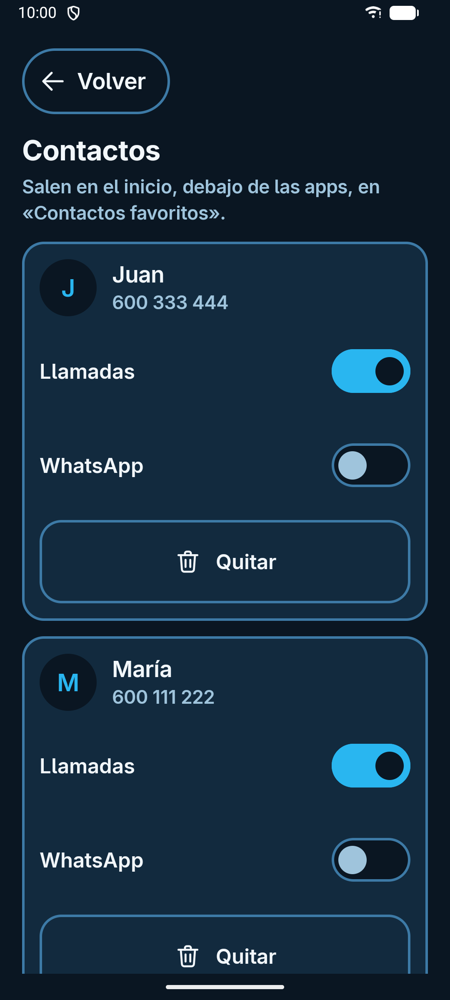
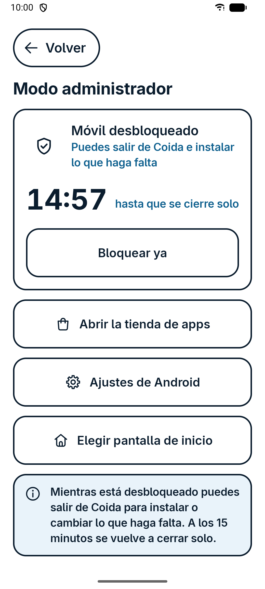

# Coida

**La pantalla de inicio de Android que tus mayores usan sin tener que aprender nada.**

**[Descargar la APK (v1.0.1)](https://github.com/JaviBrozos/Coida/releases/latest)** ·
Android 7.0 o posterior · Sin anuncios, sin cuentas y sin acceso a internet

> **En camino a Google Play.** Estamos preparando su lanzamiento en la Play Store,
> gratis y sin anuncios. La ficha, la política de privacidad y las respuestas de
> privacidad ya están preparadas ([`publishing/`](publishing)); falta la prueba
> cerrada que exige Google antes de publicar. Mientras tanto, se instala con la APK
> de arriba.

Coida es un *launcher*: cambia la pantalla de inicio del móvil por una con pocas
cosas, grandes y con mucho contraste. El móvil lo usa una persona mayor y lo
configura otra, así que tiene dos caras: un inicio en el que nada cambia de sitio
y unos ajustes detrás de un PIN para el familiar. *Coida* es «cuida» en gallego.
Hasta noviembre de 2026 se llamó Doado.

## Así se ve

| Inicio, tema oscuro | Inicio, tema claro | Letra «Enorme» | PIN de ajustes |
| :---: | :---: | :---: | :---: |
|  |  |  |  |

| Ajustes | Interfaz | Contactos | Modo administrador |
| :---: | :---: | :---: | :---: |
|  |  |  |  |

Capturas de la versión 1.0.1, con datos inventados.

## Qué hace hoy

**Para la persona mayor**, el inicio:

- Casillas grandes para **Llamadas** (abre el historial, para devolver una
  llamada con un toque), Mensajes, Cámara, Contactos y las apps que elija el
  familiar. Si una app falta, su casilla se queda en su sitio, apagada: la
  posición es memoria muscular.
- **Contactos favoritos** con la foto que tienen en la agenda: un toque y les
  llama o les abre WhatsApp.
- Una casilla **Emergencias 112**, apagada de fábrica, que abre el teléfono con
  el 112 ya marcado.
- Reloj y fecha grandes. Nada que desaparezca solo y nada que arrastrar.

**Para el familiar**, detrás de un PIN de cuatro cifras:

- **Interfaz**: cuatro tamaños de letra, de una a cuatro casillas por fila, tema
  claro u oscuro, foto de fondo y los contactos debajo de las apps o en una
  segunda pantalla.
- **Contactos**, **Aplicaciones** y **Colocar las casillas**, arrastrándolas o
  con botones.
- **Modo administrador**: durante 15 minutos, con la cuenta atrás a la vista,
  abre la tienda, los ajustes de Android y el cambio de pantalla de inicio.
  Después se cierra solo.
- Pregunta de recuperación por si se olvida el PIN, y bloqueo progresivo tras
  varios fallos.

## Lo que aprendimos probándolo con personas mayores

El 28 de octubre de 2026 lo probamos con **dos personas mayores**: una con buena
vista y soltura con el móvil, y otra de más edad y con menos manejo. Cambiamos
seis cosas, y cada una tiene su decisión razonada en
[`docs/decisiones.md`](docs/decisiones.md):

| Lo que vimos | Lo que cambiamos |
| --- | --- |
| Les sobraba tamaño. Las casillas se estiraban hasta 300 dp de alto y en un móvil bajo solo se veía una fila. Pedían cuatro por fila. | Casillas siempre cuadradas, de una a cuatro por fila. Con cuatro, en un móvil de 360 dp, quedan en unos 70 dp: por encima de los 48 dp de mínimo pulsable (D-54). |
| Molestaban las palabras partidas («Mensaje/s»). | El nombre se encoge hasta caber entero sin partir palabras, y toda la rejilla lleva la misma letra para leerse pareja (D-54). |
| El tamaño de letra «Normal» les parecía grande. | Un tamaño nuevo por debajo, a 0,85 de la escala de Android (D-55). |
| Querían ver la foto de cada contacto. | Permiso de contactos solo para leer la foto de los números guardados en Coida, nunca la agenda entera (D-57). |
| Las casillas salían en el orden en que se ponían. | «Colocar las casillas»: el familiar las arrastra o usa botones. La persona mayor nunca ve nada que se mueva (D-59). |
| La pregunta del asistente («¿Llamo a María?») las liaba, y el micrófono recogía la tele. | El asistente dice lo que va a hacer y lo hace, con «Cancelar» mientras habla (D-56), y el final de la frase se mide contra la propia voz (D-58). |

### Y quitamos el asistente de voz

Coida nació con un asistente de voz con IA como pieza central: pulsas un círculo,
dices «llama a María» y lo hace, o te explica cómo hacerlo. Lo programamos entero:
grabación con detección de voz propia, transcripción con Whisper, un modelo de
lenguaje que contesta en JSON validado contra una lista blanca de contactos y
casillas, y dos modos que elige el familiar.

Al probarlo, **no les resultó útil**. Lo que usaban eran las casillas y los
contactos del inicio, que ya conocían. Así que la versión pública sale sin él
(D-67). Hay además una razón técnica: sin servidor propio, la clave del servicio
de IA tendría que ir dentro de la APK, y de ahí se puede sacar (D-63).

El código sigue en la versión de depuración, por si sirve con otro planteamiento:
mira [Probar el asistente con tu propia clave](#probar-el-asistente-con-tu-propia-clave).

## Por qué es técnicamente interesante

- **Dos permisos y sin internet.** La APK pública solo pide `CALL_PHONE` y
  `READ_CONTACTS`, y no declara `INTERNET`. Los dos se piden al añadir un
  contacto, con el familiar delante, nunca en el inicio. Tampoco hay
  `QUERY_ALL_PACKAGES`: el bloque `<queries>` declara solo lo que Coida tiene que
  encontrar.
- **Lo que no se publica, no está.** El asistente va detrás de
  `BuildConfig.ASSISTANT_ENABLED`. En release, R8 quita su código, las claves del
  proveedor van vacías y los permisos de micrófono e internet solo existen en
  `src/debug/AndroidManifest.xml`. La APK de release pesa menos de 2 MB (D-63).
- **Un PIN que no se guarda.** Se deriva con PBKDF2 (HMAC-SHA1, 10 000 vueltas,
  sal aleatoria de 16 bytes), se compara en tiempo constante y no sale en la copia
  de seguridad. Tras el quinto fallo se bloquea 30 s, y sube hasta una hora; el
  tiempo se mide con el reloj monotónico, así que cambiar la hora o reiniciar no
  lo acorta (D-19, D-24, D-49).
- **Accesibilidad con números.** Texto a 4,5:1 como mínimo, buscando 7:1, medido
  contra el fondo real en el que cae. El marino de la marca da 17,08:1 sobre
  blanco; el cian, solo 2,32:1, así que nunca se usa para texto ni iconos sobre
  claro. Nada pulsable por debajo de 48 dp. Separación por borde de 2 dp, nunca
  por sombra. Letra Inter con el juego `ss04`, para que la I y la l no se
  confundan.
- **Sin color dinámico.** Material You toma los colores del fondo de pantalla, y
  así no se puede garantizar el contraste (D-02).
- **Funciona en cualquier marca.** Las casillas se definen por acción de Android
  (`ACTION_DIAL`, `CATEGORY_APP_MESSAGING`…), no por paquete. Ningún intent se
  lanza a pelo: cada uno tiene su reserva, y si todo falla, un aviso en lenguaje
  llano.
- **Pocas piezas.** Kotlin y Jetpack Compose (Material 3), AGP 9.3 con Kotlin
  integrado, minSdk 24 y targetSdk 37. Un solo módulo, sin XML de layouts, sin
  librería de navegación (un `enum` y un `when`), sin ViewModel, sin base de datos
  (`SharedPreferences`) y sin dependencias de terceros: solo AndroidX y Compose.
  Unas 10 500 líneas de Kotlin en 47 ficheros, organizadas por funcionalidad.
- **Documentación como código.** Una especificación de requisitos
  ([`docs/ERS.md`](docs/ERS.md)) con 16 casos de uso y 19 requisitos no
  funcionales; **68 decisiones** en [`docs/decisiones.md`](docs/decisiones.md),
  cada una con lo que se descartó y por qué; y un
  [`docs/estado.md`](docs/estado.md) que se actualiza en cada cambio. En
  [`.claude/`](.claude) están las normas de trabajo (7 ficheros), 3 subagentes
  (accesibilidad, marca y presentación del repositorio) y la skill de marca, para
  que quien toque el código, persona o agente de IA, siga las mismas reglas.

## Cómo lo hemos hecho con Claude Code

Casi todo el proyecto lo hemos escrito trabajando con
[Claude Code](https://claude.com/claude-code): casi todos los commits llevan su
firma (`Co-Authored-By`). Pero no es *vibecoding*, eso de pedir algo, aceptar lo
que salga y seguir. Le hemos montado un **arnés**: contexto escrito, normas,
revisores y comprobaciones, para que trabaje como un ingeniero más del equipo. Las
decisiones de producto las tomamos nosotros y las personas mayores que lo probaron;
Claude propone, ejecuta y demuestra que funciona.

### Las piezas del arnés

| Pieza | Qué hace |
| --- | --- |
| [`CLAUDE.md`](CLAUDE.md) | El índice del proyecto: qué es Coida, los cinco invariantes que no se rompen, lo que no va a hacer nunca, los comandos y cómo recuperar el móvil si el launcher falla. Incluye lo obligatorio en cada cambio. |
| [`.claude/rules/`](.claude/rules) | Siete normas. Tres se cargan siempre (accesibilidad, producto y flujo de trabajo); las otras cuatro solo al abrir un fichero de su zona (Compose, datos y manifiesto, recursos, asistente). Así el contexto es corto y relevante. |
| [`.claude/agents/`](.claude/agents) | Tres subagentes con un papel fijo. El de **accesibilidad** (WCAG 2.2 AA, Android y Material 3) y el **auditor de marca** solo leen y proponen; toda pantalla nueva pasa por el primero. El **presentador** escribió este README con una condición: cada cifra, con su fuente. |
| [`.claude/skills/`](.claude/skills) | La marca de Coida (`coida-brand`), un marco para auditar identidades visuales y los principios de diseño de Apple, este último como inspiración. Cuando chocan, mandan las normas de Coida. |
| [`docs/`](docs) | La memoria del proyecto: la ERS es la fuente única de los casos de uso, `decisiones.md` guarda 68 decisiones con lo que se descartó y `estado.md` se actualiza en cada cambio. |

### Contra las alucinaciones

- **El código manda.** Si un documento y el código no cuadran, gana el código y el
  documento se corrige en el mismo commit. Si no da tiempo, se borra la frase:
  vacío es mejor que falso.
- **Una sola fuente para cada cosa.** Los requisitos solo viven en la ERS, los
  colores en `Color.kt` y las medidas en `Dimens.kt`. Si un documento repite una
  cifra y no cuadra, se corrige el documento.
- **Nada inventado.** No hay pruebas automáticas y las normas lo dicen, para que
  nadie se invente un comando de test. Antes de proponer sintaxis de Gradle, se lee
  el catálogo de versiones: AGP 9 no se parece a lo que hay en internet.
- **Lo que dice un agente se comprueba.** Al preparar esta publicación, un
  subagente aseguró que la APK lista para subir era otra variante. Comparamos el
  hash y los permisos con `aapt`: era la correcta y el agente se equivocaba. No se
  actuó sobre su palabra.
- **Decisiones cerradas y abiertas.** Las cerradas no se reabren dentro de otra
  tarea. Si una tarea depende de un conflicto abierto de la ERS, Claude para y
  pregunta, porque es una decisión de los dos creadores.

### Revisión en vez de vibecoding

- **Plan antes de tocar nada.** En los cambios grandes, Claude audita el código,
  escribe un plan por fases y nos pregunta lo que solo podemos decidir nosotros,
  como el nombre, el `applicationId` o el alcance. Con el plan aprobado, se ejecuta.
- **Hecho quiere decir comprobado.** Una pantalla está terminada cuando compila,
  `lint` da 0 errores, cumple los criterios de su caso de uso en la ERS, pasa el
  repaso de accesibilidad y se ha visto funcionando en el emulador, no solo
  compilando.
- **Pruebas de verdad, a mano.** Capturas en el emulador, letra del sistema al
  200 %, giro, modo avión, matar el proceso y reiniciar. Además, el manifiesto
  fusionado de la release y un `grep` del `dex` para demostrar que no lleva la
  clave ni el código del asistente.
- **Cambios pequeños y trazables.** Un commit por fase, el código y la
  documentación por separado, y mensajes en español que explican el porqué.
- **Nada hacia fuera sin permiso.** Hacer público el repositorio, subir o
  publicar algo siempre lo confirma una persona. Antes de abrir el repo se
  revisó el historial entero en busca de claves.

El punto débil sigue ahí y lo decimos: sin pruebas automáticas, la red de seguridad
es esta revisión manual.

## Quiénes somos

Somos dos estudiantes de Ingeniería Informática:

- **Javier Brozos Martínez**, en la Universidad Politécnica de Madrid (UPM).
- **Gonzalo Gómez Blanco**, en la Universidade da Coruña (UDC).

Coida es un proyecto personal de los dos, empezado en septiembre de 2026. Si
quieres comentarnos algo, abre un *issue* en este repositorio.

## Cómo probarlo

1. En el móvil, [descarga `Coida-1.0.1.apk` de la última Release](https://github.com/JaviBrozos/Coida/releases/latest).
2. Ábrela. Android te pedirá permiso para instalar apps de origen desconocido
   desde el navegador o el gestor de archivos: concédelo para esta instalación.
3. Abre Coida. Arriba verás un aviso de que aún no es la pantalla de inicio, con
   un botón para ponerla. También puedes pulsar Inicio y elegir Coida → *Siempre*,
   o ir a *Ajustes → Aplicaciones → Aplicaciones predeterminadas → App principal*.
4. Toca el engranaje de la esquina para entrar en Ajustes: la primera vez te pide
   crear el PIN.

Cuando llegue a Google Play, bastará con buscar «Coida» e instalarla desde allí.

Hace falta **Android 7.0 o posterior**. Es la misma versión que irá a Google Play:
sin asistente, sin internet y con dos permisos. Va **firmada para pruebas** (con
la clave de depuración), así que si luego quieres la de Google Play tendrás que
desinstalar esta antes, y se pierden el PIN, los contactos y las casillas.

## Cómo dejárselo configurado a tu mayor

Coida la configura el familiar una vez, con el móvil en la mano, y después la
persona mayor solo usa el inicio. Se tarda unos diez minutos. Hazlo tú, no
delante de ella: los permisos de Android se piden en este rato, y así nunca ve
un diálogo que no entiende.

1. **Ponla como pantalla de inicio.** Instala Coida y pulsa el aviso de arriba,
   «Coida aún no es la pantalla de inicio de este móvil», o pulsa Inicio y elige
   Coida → *Siempre*. A partir de ahí, el botón Inicio siempre lleva a Coida.
2. **Crea el PIN.** Toca el engranaje de la esquina. La primera vez te pide cuatro
   cifras que solo sepas tú. Después, pon una **pregunta de recuperación**: si
   olvidas el PIN, con ella pones uno nuevo sin perder nada. Sin ella, la única
   salida es borrar los datos de la app.
3. **Añade sus personas** en *Ajustes → Contactos → Añadir contacto*. Eliges a
   cada una de la agenda y, para cada una, enciendes su botón de **Llamadas**, el
   de **WhatsApp** o los dos. Aquí Android te pide dos permisos: llamar con un
   toque y ver la foto que tiene en la agenda. Si dices que no, sigue
   funcionando: abre el marcador y pone la inicial.
4. **Elige qué casillas salen** en *Ajustes → Aplicaciones*. Las básicas son
   Llamadas, Mensajes, Cámara y Contactos. **Emergencias 112** viene apagada:
   enciéndela si quieres que tenga a mano el teléfono con el 112 ya marcado (para
   llamar hay que pulsar el botón verde, así no se llama sin querer). Debajo, en
   «Otras apps de este móvil», subes al inicio cualquier otra, como WhatsApp o la
   radio.
5. **Colócalas** en *Ajustes → Colocar las casillas*: arrastra cada casilla y
   cada contacto, o usa los botones, hasta dejarlos donde los vaya a buscar. Pon
   arriba lo que más use. Después no lo cambies: la posición es memoria muscular.
6. **Ajusta cómo se ve** en *Ajustes → Interfaz*, donde los cambios se ven al
   momento:
   - **Tamaño de la letra**: Normal, Grande, Muy grande o Enorme. Se suma al que
     tenga puesto Android.
   - **Casillas por fila**: de 1 a 4. Con menos, más grandes. Con 4 cabe más,
     pero pruébalo con ella antes.
   - **Contactos en el inicio**: debajo de las apps o en una segunda pantalla con
     sus pestañas.
   - **Tema** claro u oscuro, una **foto de fondo** si le hace ilusión y si se ve
     o no el **reloj**.
7. **Antes de irte**, en *Ajustes → Modo administrador*, pulsa «Desbloquear 15
   minutos» si necesitas instalar una app desde la tienda o tocar los ajustes de
   Android. Se vuelve a cerrar solo. Para el volumen y el brillo, *Ajustes →
   Sonido y pantalla* lleva directo a los de Android.

Luego dale el móvil y enséñale tres cosas: dónde está cada casilla, que el botón
Inicio siempre la trae de vuelta y que el engranaje es tuyo. Si entra sin querer,
la pantalla del PIN tiene un botón grande para volver al inicio.

### Si algo se rompe

Un launcher roto deja el móvil sin pantalla de inicio. Para recuperarla:

- **En el móvil**: *Ajustes → Aplicaciones → Aplicaciones predeterminadas → App
  principal*, y elige otra.
- **Desde el ordenador**:

  ```bash
  adb shell cmd package set-home-activity <otro.paquete/.SuActividad>   # devolver el mando
  adb uninstall com.coida.launcher                                      # último recurso
  ```

Si se olvida el PIN y no se fijó pregunta de recuperación, la única salida es
borrar los datos de la app o desinstalarla, y se pierde lo configurado.

## Cómo compilarlo

Necesitas una versión de Android Studio que admita AGP 9.3 (trae su propio JDK)
y un `local.properties` en la raíz con la ruta del SDK. Está en `.gitignore`,
porque es propio de cada equipo:

```properties
sdk.dir=C\:\\Users\\<usuario>\\AppData\\Local\\Android\\Sdk
```

```bash
./gradlew assembleDebug     # APK de depuración, con el asistente si hay clave
./gradlew installDebug      # la instala en el móvil o emulador conectado
./gradlew assembleRelease   # APK de release: sin asistente, con R8
./gradlew bundleRelease     # el .aab para Google Play
./gradlew lint              # análisis estático
```

Sin `keystore.properties` (fuera de git), la release se firma con la clave de
depuración: vale para probar, no para Google Play. Hay además una variante
`familia` (`./gradlew assembleFamilia`), la release más un aviso de llamadas
perdidas en la casilla «Llamadas»; necesita `READ_CALL_LOG`, que Google Play no
permite a un launcher, y por eso solo se instala a mano (D-66).

No hay pruebas automáticas: se compila y se prueba a mano en el emulador. Para
verlo como pantalla de inicio desde el ordenador:

```bash
adb shell cmd package set-home-activity com.coida.launcher/.LauncherActivity
```

## Probar el asistente con tu propia clave

El asistente solo existe en la versión de depuración y no trae ninguna clave.
Para probarlo:

1. Consigue una clave gratuita de [Groq](https://console.groq.com) y ponla en tu
   `local.properties`:

   ```properties
   coida.ai.apiKey=tu_clave
   ```

2. Compila e instala: `./gradlew installDebug`.
3. En Coida, entra en *Ajustes → Asistente de voz* y enciéndelo. Te pedirá el
   permiso del micrófono, y aparecerá un círculo en el inicio.

Vale cualquier proveedor con API compatible con OpenAI (`/audio/transcriptions`
y `/chat/completions`): las claves opcionales `coida.ai.baseUrl`,
`coida.ai.sttModel`, `coida.ai.llmModel` y `coida.ai.reasoningEffort`, con sus
valores por defecto, están en [`docs/arquitectura.md`](docs/arquitectura.md#configuración-del-proveedor).
En el emulador, para hablarle: *Extended controls → Microphone → Virtual
microphone uses host audio input*.

> **Tu clave queda dentro de la APK de depuración**, y de ahí se puede sacar. Esa
> APK es solo para ti: no la compartas ni la subas a ningún sitio. Al servicio
> solo le llegan la voz y los nombres, nunca los números de teléfono.

## Límites conocidos

- **Probado a mano, no en serie.** No hay pruebas automáticas. La 1.0.1 se ha
  probado en el emulador (API 37); la prueba con personas mayores fue con dos
  personas y con la versión anterior.
- **Falta probar** «Llamadas» en móviles Samsung y Xiaomi, y la instalación desde
  Google Play en un móvil real.
- **Repaso de accesibilidad con tareas abiertas**: un campo de texto sin
  etiqueta, botones apagados que TalkBack no explica y la barra de «Colocar las
  casillas» con letra grande en horizontal, entre otras ([`docs/estado.md`](docs/estado.md)).
- **El modo administrador no impide salir a Android**: cierra las salidas de
  Coida. Impedirlo de verdad exigiría que Coida fuera propietaria del
  dispositivo, y está descartado (D-16).
- La cuenta atrás del modo administrador va contra la hora del sistema:
  cambiarla altera el desbloqueo.
- El número de un contacto se guarda al añadirlo; si cambia en la agenda, Coida
  sigue con el viejo. La foto sí se actualiza.
- Sin videollamada: Android no ofrece una forma estándar de iniciarla.
- Solo en español.
- El asistente no se puede publicar mientras su clave tenga que ir dentro de la
  APK (CON-06 en la ERS).
- Todavía no hay licencia: el código se puede leer, pero sus derechos están
  reservados.

## Documentación

| Dónde | Qué hay |
| --- | --- |
| [`docs/ERS.md`](docs/ERS.md) | Especificación de requisitos: actores, casos de uso con su estado, requisitos no funcionales, glosario y conflictos abiertos. |
| [`docs/arquitectura.md`](docs/arquitectura.md) | Cómo está hecho por dentro: navegación, estado, qué se guarda, los intents con sus reservas, el manifiesto y el asistente. |
| [`docs/diseno.md`](docs/diseno.md) | Paleta con sus contrastes, tipografía, medidas, iconos y componentes. |
| [`docs/decisiones.md`](docs/decisiones.md) | Por qué cada cosa es como es y qué se descartó por el camino. |
| [`docs/estado.md`](docs/estado.md) | En qué punto está el trabajo. Es el único documento que caduca. |
| [`publishing/`](publishing) | Para Google Play: política de privacidad, «Seguridad de los datos», permisos, ficha y capturas. |
| [`design/presentacion/coida-de-un-vistazo.pdf`](design/presentacion/coida-de-un-vistazo.pdf) | El proyecto en diez láminas, en PDF. |
| [`web/index.html`](web/index.html) | La web de presentación. Se abre en el navegador, sin servidor. |
| [`.claude/skills/coida-brand/`](.claude/skills/coida-brand) | La marca: logo, colores, iconos, letra, tono y los ficheros del logotipo. |
| [`CLAUDE.md`](CLAUDE.md) y [`.claude/rules/`](.claude/rules) | El índice del proyecto y las normas de trabajo para quien toque el código. |
| [`design/video/`](design/video) | Vídeo de marca y su código, del prototipo, con el nombre anterior y el asistente. |

Si un documento y el código no cuadran, manda el código.
